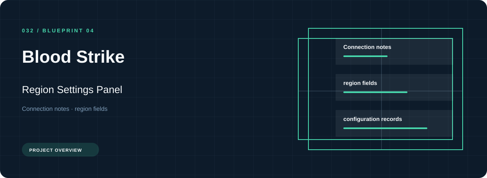
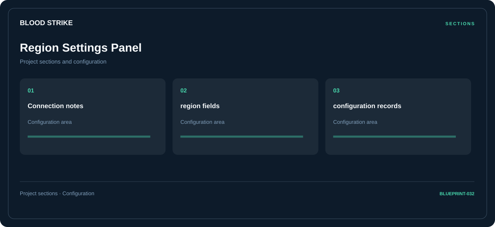

# 🛠️ Blood Strike Region Settings Panel

**Connection notes · Region fields · Configuration records**

## ⚡ Features

Use the Blood Strike region settings panel workspace to move between connection notes, region fields, and configuration records. The section map below gives each part a clear place in the project.

### ⚙️ Connection notes

A dedicated section for connection notes and the configuration details associated with that area.

### 🧩 Region fields

A dedicated section for region fields and the configuration details associated with that area.

### ⌨️ Configuration records

A dedicated section for configuration records and the configuration details associated with that area.

## 🖥️ Project navigation

## 📥 Download

The button and cover open the project's download page. Use the information supplied with the downloaded package for installation and release-specific requirements.

## 📚 Project documentation

- [Feature reference](docs/FEATURES.md)
- [Download information](docs/DOWNLOAD.md)
- [Project page](index.html)

---

Blood Strike Region Settings Panel · Program documentation and download information.
